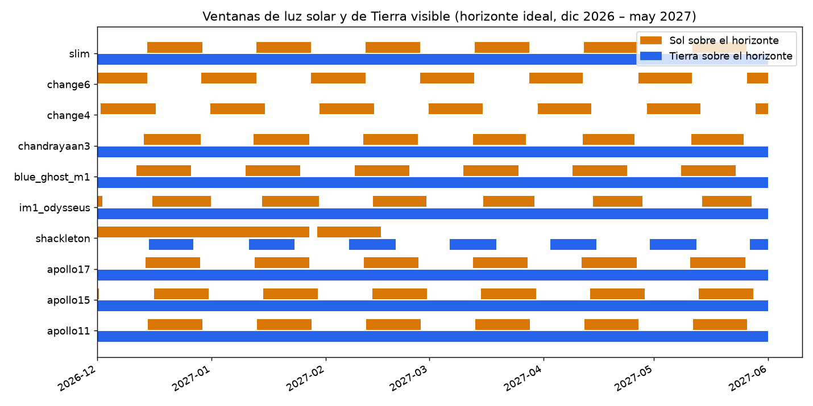
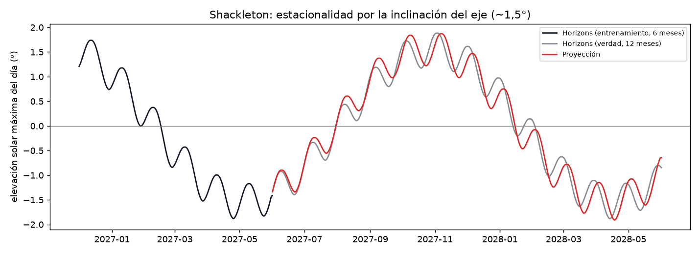
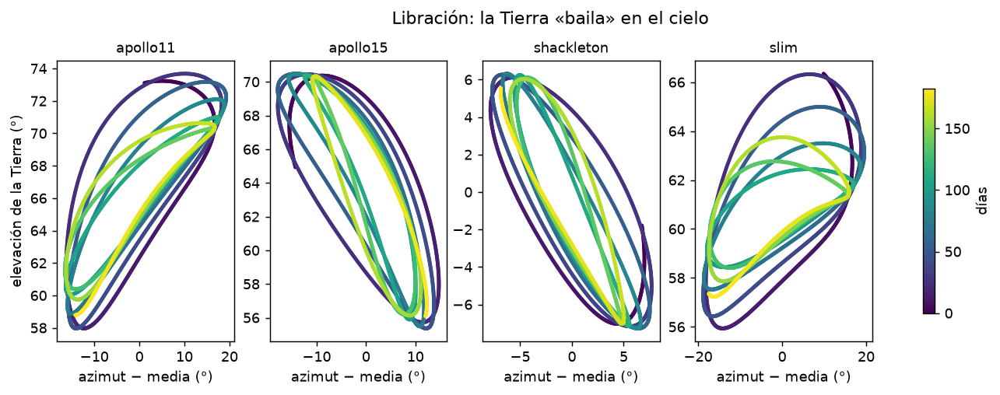
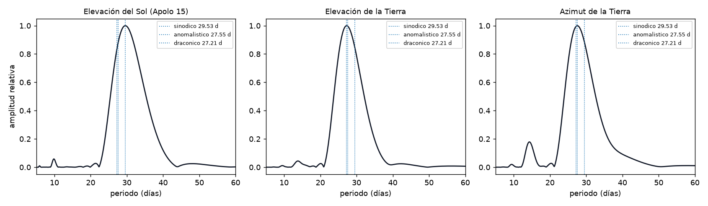
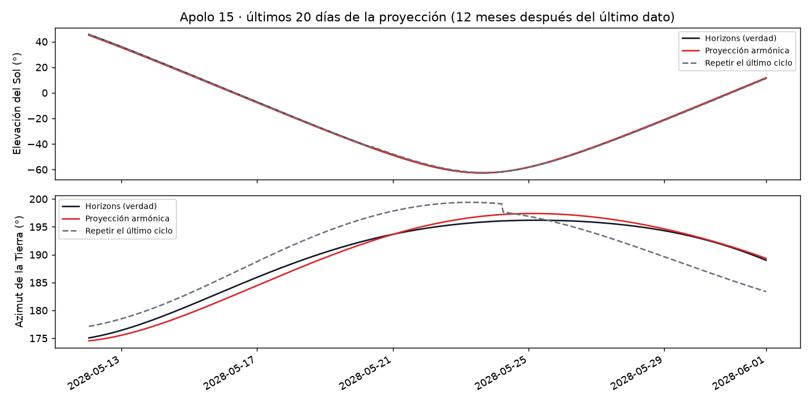
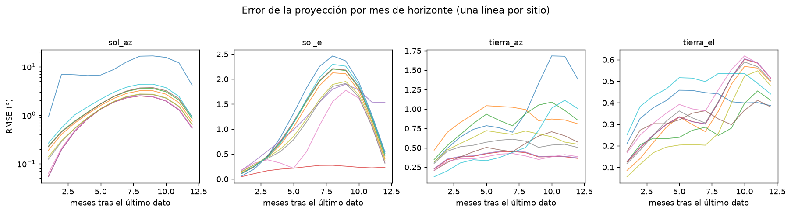
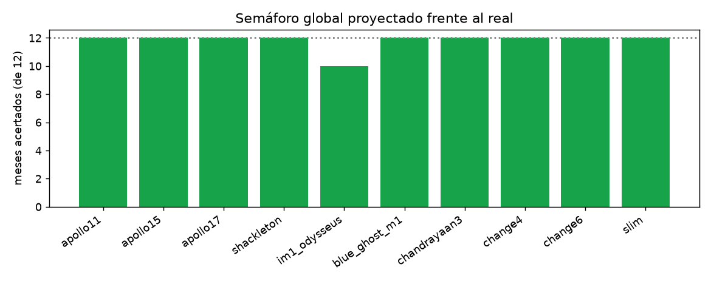

# Análisis con Polars y proyección del cielo lunar

## Executive summary (English; the full report is in Spanish below)

We analysed six months (Dec 2026 – May 2027, hourly) of real NASA/JPL Horizons ephemerides for 10 lunar sites with a Polars pipeline and an FFT, projected the next 12 months with a harmonic model, and validated the projection against the 12 months that Horizons itself computes for that period.

- **The lunar sky is a clock.** A lunar day lasts 29.53 days: at the 9 non-polar sites the Sun stays up for about 14.4–14.8 days and then down for as long. The Earth is above the horizon all the time at the 7 near-side sites and never at the two far-side sites (Chang'e 4 and 6).
- **Shackleton has seasons.** Because of the 1.54° axial tilt, the Sun shines continuously from August to December 2027 and is almost absent from March to July 2027 (ideal horizon). The Earth wobbles (libration): its azimuth ranges 11–38° and its elevation 10–20° depending on the site.
- **Projection skill, measured honestly.** Against a naive "repeat the last cycle" baseline, the mean error drops from 1.84° to 1.19° for the Sun's elevation and from 3.41° to 0.62° for the Earth's azimuth. The projected viability traffic light matches the real one in 118 of 120 site-months.
- **Where it fails.** Near the zenith (Apollo 11: solar azimuth RMSE 10.6°) and for sunrise/sunset times at the pole, where the Sun grazes the horizon.
- **What it is not.** It does not replace physical ephemerides: Horizons stays the source of truth. It is meant to explore trends and animate the sky beyond the data range, and the API (`GET /api/simulacion/{site_id}`) labels every point as `datos` or `proyeccion` with its measured uncertainty.
- **Caveats.** Model variants were discarded after looking at the validation error, so the figures are not a strict blind test. Elevations assume an ideal horizon (no terrain). Data: NASA/JPL Horizons; NASA does not endorse this project.

---

Seis meses de efemérides reales de Horizons (2026-12-01 → 2027-06-01, 10 sitios, paso de 1 h) se analizan con un pipeline de Polars y se proyectan 12 meses más (2027-06 → 2028-06) con un modelo armónico. La proyección se **valida contra los 12 meses reales** que Horizons calcula para ese periodo (la verdad de terreno).

> **En una frase.** La rotación lunar es determinista y Horizons ya la calcula, así que la proyección **no sustituye a las efemérides físicas**. Su valor es poder explorar tendencias y animar el cielo más allá del rango de datos con un error conocido, y por eso la API devuelve la incertidumbre medida en la validación.

## 1. Librería: Polars, numpy y matplotlib solo en scripts
- **Polars en lugar de pandas:** consultas `LazyFrame` componibles y optimizadas (cada paso del pipeline es una función pura `LazyFrame → LazyFrame`), fechas con zona UTC tipadas y `group_by_dynamic` para meses naturales.
- **Parquet nativo** para la verdad de terreno (1,8 MB para 87 850 filas) sin añadir `pyarrow`; pandas lo necesita.
- **Instalación sin compilar:** comprobado con `pip download --only-binary=:all:` para Python 3.12 en `manylinux2014` de `x86_64` y `aarch64`. Resultan `polars==2.1.0` (con `polars-runtime-32`) y `numpy 2.2.6`. La API usa numpy para la FFT y el ajuste. **matplotlib** solo está en `scripts/datos/requirements.txt`.

## 2. Pipeline reutilizable (`app/analysis/`)
| Módulo | Qué hace |
|---|---|
| `frames.py` | Construye el `LazyFrame` desde las filas que ya valida `services.lectura.ephemeris` (no hay un segundo lector de CSV) o desde el Parquet. |
| `pipeline.py` | Ventanas de luz y de Tierra (inicio, fin, duración), puestas y salidas, estadísticas por día lunar, extremos diarios, % por mes y libración. |
| `spectrum.py` | Periodograma con ventana de Hann y relleno de ceros; picos dominantes y qué periodos conocidos caben dentro de la resolución. |
| `harmonic.py` | Ajuste por mínimos cuadrados regularizados y afinado del periodo. |
| `projection.py` | Modelo de Sol y Tierra y referencia ingenua. |
| `validation.py` | Error en grados, en horas de puestas y aciertos del semáforo. |
| `simulacion.py` | Servicio del endpoint. |

## 3. Qué muestran los datos reales (6 meses, 10 sitios)



- **Ventanas de luz:** en los 9 sitios que no son polares, cada ventana de Sol dura unas **345–356 h (≈14,4–14,8 días)** y cada noche otras 353–359 h: justo medio día lunar de 29,53 días. Son 6 ventanas de Sol y 5 o 6 noches completas en 6 meses. Cada sitio tiene su propio desfase.
- **Tierra:** en los 7 sitios de la cara visible no hay ninguna ventana: está sobre el horizonte las 4369 h. En Chang'e 4 y 6 (cara oculta) nunca sale. **Shackleton es el único con ventanas de Tierra**: 6 tramos visibles de unas 300 h y 6 ocultos de unas 352 h, alternando cada ~27 días.
- **Polo sur:** Shackleton tiene **una sola ventana de Sol completa (413 h)** y una noche completa de 54 h; el resto es noche hasta el final de los datos. El Sol pasa de 100 % en diciembre a casi nada de marzo a julio (0 % de marzo a junio y 1,2 % en julio; ver §3.1). IM-1 (80°S) tuvo Sol el 56 % del tiempo en diciembre de 2026, pero muy bajo en el cielo.
- **Por día lunar:** las horas de Sol de un día lunar completo van de 299 h (Shackleton) a 356 h; en latitudes medias son estables de un día lunar a otro (355 h de media).

### 3.1 Estacionalidad en el polo: la inclinación del eje



La elevación solar máxima diaria en Shackleton oscila entre **−1,88° y +1,88°**. Coincide con lo esperable: la inclinación del eje lunar (**1,54°**) más la colatitud del punto (90° − 89,66° = **0,34°**). Con horizonte ideal, el Sol no sale (0 %) de marzo a junio de 2027 y apenas en julio (1,2 %), y vuelve a faltar de marzo a mayo de 2028; brilla de forma continua de agosto a diciembre de 2027 (100 % de Sol cinco meses seguidos). El ciclo es coherente con el «año de eclipses» (346,6 días), no con un año de 365 días.

### 3.2 Libración: la Tierra «baila»



La Tierra no está fija en el cielo lunar: su azimut oscila entre **11° y 38°** de rango y su elevación entre **10° y 20°**, según el sitio. Esa oscilación es lo que hace que en Shackleton, cerca del horizonte, la Tierra salga y se ponga cada mes.

### 3.3 Periodicidades con FFT



- El pico del **mes sinódico** aparece en **29,54–29,57 días** en la elevación solar de los 10 sitios (29,53 d teóricos).
- La libración da un pico único entre **26,7 y 27,6 días** según el sitio y la variable: en la elevación de la Tierra cae entre **27,17 y 27,52 d** (cerca del mes dracónico, 27,21 d, libración en latitud) y en el azimut entre **26,67 y 27,61 d** (mes anomalístico, 27,55 d, libración en longitud). La dispersión es la propia imprecisión de la FFT con solo 6 ciclos.
- **Límite honesto de la FFT:** con 182 días de datos la resolución es P²/T ≈ 4–5 días. El sinódico, el anomalístico y el dracónico caen dentro del mismo lóbulo y **no se pueden separar** solo con la FFT. Por eso el modelo fija los periodos físicos conocidos y la FFT solo confirma el pico y ayuda a afinar el sinódico.
- Los periodos largos (año de eclipses, 346 d) no son identificables con menos de un ciclo.

## 4. Modelo de proyección

Se ajusta el **vector unitario de dirección** (este, norte, arriba) de cada astro con una suma de senos y cosenos, y luego se normaliza y se convierte a azimut y elevación. Trabajar con el vector evita desenrollar ángulos y no se rompe cuando el azimut gira de golpe cerca del cénit.

- **Sol:** armónicos `k·f_sinódico` (k = 1..8), el mes anomalístico y su segundo armónico, y las bandas laterales `k·f_sinódico ± f_anomalístico` (k = 1..2), que incluyen el batido de ~411 días. El periodo sinódico se afina alrededor del pico de la FFT.
- **Tierra:** libración con periodos físicos fijos: anomalístico, dracónico, su segundo armónico anomalístico y los términos solares de la «variación» (`2·f_sinódico`) y la «evección» (`2·f_sinódico ± f_anomalístico`).
- **Elevación del Sol:** una validación cruzada dentro de los datos (entrena con los dos primeros tercios y prueba en el último) elige entre la elevación del vector y un ajuste directo con su propio periodo. Gana el directo en los polos (Shackleton e IM-1), donde la elevación casi no se mueve.
- **Qué NO se hizo:** no se ajustan periodos largos independientes (con menos de un ciclo hacen explotar la extrapolación; lo comprobé con una versión que los incluía), y no se afinan los periodos de la libración (con 6 meses eran colineales y empeoraban la proyección).
- **Cómo se eligió:** la complejidad (qué términos entran) se decidió con la validación cruzada dentro de los 6 meses de entrenamiento, no mirando la verdad. Las pruebas exploratorias contra la verdad sirvieron para descartar versiones evidentemente malas (por ejemplo, la que incluía el año de eclipses), y eso hay que tenerlo en cuenta: **las cifras de abajo no son una prueba ciega estricta**.

## 5. Validación contra la verdad de Horizons

Verdad de terreno: `scripts/datos/validacion/horizons_verdad.parquet` (2027-06-01 → 2028-06-01, 10 sitios × 8785 filas, 1,8 MB). Se versiona en el repositorio porque pesa poco y permite repetir y revisar la validación sin red; no se sirve por la API. Se descarga con `scripts/datos/descargar_validacion.py`.



**Revisión de datos: APROBADA, y reproducible.** Una verificación independiente (la revisión de datos) confirmó el esquema y la continuidad del Parquet (la primera fila de cada sitio es idéntica a la última de los datos de entrenamiento), 16 consultas propias a Horizons sin diferencias, y recalculó el error con su propio código con el mismo resultado hasta el 4.º decimal. Las comprobaciones están en un script que cualquiera puede repetir; imprime una línea por comprobación y termina con `APROBADO` (código 0) o `CORREGIR` (código 1):

```bash
python scripts/datos/revisar_validacion.py              # esquema, filas, paso de 1 h, rangos, saltos, continuidad con los CSV y tabla de errores
python scripts/datos/revisar_validacion.py --horizons   # además, 6 consultas de control propias a JPL Horizons (necesita red)
```

### 5.1 Error en grados (RMSE; entre paréntesis, la referencia ingenua «repetir el último ciclo»)

| Sitio | Azimut Sol | Elevación Sol | Azimut Tierra | Elevación Tierra |
|---|---|---|---|---|
| apollo11 | 10.64 (15.87) | 1.54 (1.90) | 1.05 (7.36) | 0.40 (1.49) |
| apollo15 | 2.01 (2.91) | 1.32 (1.82) | 0.88 (4.04) | 0.37 (2.75) |
| apollo17 | 2.23 (3.30) | 1.38 (1.83) | 0.85 (4.88) | 0.30 (1.56) |
| shackleton † | 1.55 (1.93) | 0.22 (1.80) | 0.39 (1.54) | 0.40 (2.87) |
| im1_odysseus † | 1.56 (1.93) | 1.31 (1.81) | 0.40 (1.56) | 0.40 (2.88) |
| blue_ghost_m1 | 2.30 (3.30) | 1.40 (1.86) | 0.51 (3.34) | 0.33 (1.32) |
| chandrayaan3 | 1.58 (1.96) | 0.97 (1.84) | 0.37 (1.40) | 0.43 (2.98) |
| change4 | 1.68 (2.31) | 1.15 (1.79) | 0.53 (2.14) | 0.40 (2.87) |
| change6 | 1.71 (2.40) | 1.19 (1.78) | 0.61 (3.08) | 0.32 (2.33) |
| slim | 2.72 (3.95) | 1.43 (1.93) | 0.63 (4.80) | 0.47 (2.33) |
| **Media de los 10 sitios** | **2.80** (3.99) | **1.19** (1.84) | **0.62** (3.41) | **0.38** (2.34) |

† Elevación del Sol ajustada directamente (elegida por la validación cruzada).

- En media, el modelo reduce el error de la referencia ingenua en **la elevación del Sol (1,19° frente a 1,84°)**, **el azimut del Sol (2,80° frente a 3,99°)**, **el azimut de la Tierra (0,62° frente a 3,41°)** y **la elevación de la Tierra (0,38° frente a 2,34°)**. La mejora de la libración es de 5 a 6 veces; la del Sol es modesta salvo en los polos, donde la elevación es 8 veces mejor en Shackleton.
- **Dónde falla: Apolo 11 (0,67° N).** El Sol pasa casi por el cénit (88–89,6°) y el azimut gira hasta 87° por hora. El RMSE del azimut solar es de **10,6°** (la referencia ingenua da 15,9°). Por eso la API avisa de que el azimut solar proyectado no es fiable cuando el Sol supera 85° de elevación.

### 5.2 Error por mes de horizonte (RMSE medio de los sitios, en grados)

| Mes de horizonte | Azimut Sol | Elevación Sol | Azimut Tierra | Elevación Tierra |
|---|---|---|---|---|
| 1 | 0.15 | 0.12 | 0.27 | 0.14 |
| 3 | 0.62 | 0.42 | 0.50 | 0.28 |
| 6 | 2.16 | 1.24 | 0.61 | 0.34 |
| 9 | 3.03 | 1.89 | 0.69 | 0.45 |
| 12 | 0.71 | 0.52 | 0.68 | 0.46 |

Excluye el azimut solar de Apolo 11. El error **no crece de forma monótona**: oscila con el batido de ~411 días, con un máximo hacia los meses 8–10 y valores bajos en los extremos.



### 5.3 Puestas del Sol y semáforo

| Sitio | Puestas del Sol reales | Emparejadas (<24 h) | Error medio (h) | Semáforo energía | Semáforo comunicación | Semáforo global |
|---|---|---|---|---|---|---|
| apollo11 | 25 | 100 % | 2.5 | 12/12 | 12/12 | 12/12 |
| apollo15 | 25 | 100 % | 2.5 | 12/12 | 12/12 | 12/12 |
| apollo17 | 25 | 100 % | 2.5 | 12/12 | 12/12 | 12/12 |
| shackleton | 4 | 25 % | 3.0 | 12/12 | 12/12 | 12/12 |
| im1_odysseus | 25 | 76 % | 11.3 | 10/12 | 12/12 | 10/12 |
| blue_ghost_m1 | 25 | 100 % | 2.6 | 12/12 | 12/12 | 12/12 |
| chandrayaan3 | 25 | 100 % | 3.9 | 12/12 | 12/12 | 12/12 |
| change4 | 25 | 100 % | 2.5 | 12/12 | 12/12 | 12/12 |
| change6 | 25 | 100 % | 2.6 | 12/12 | 12/12 | 12/12 |
| slim | 25 | 100 % | 2.5 | 12/12 | 12/12 | 12/12 |



- **Latitudes medias y bajas (8 sitios):** las 25 puestas y salidas del Sol de los 12 meses se emparejan con una proyectada a menos de 24 h, con un error medio de **2,5–3,9 h**. Es coherente con que el Sol cambia unos 0,5° por hora y su elevación tiene un error de 1–1,5°.
- **Dónde falla (polo con el Sol rasante):** en Shackleton hay solo 4 cambios de estado del Sol en 12 meses y solo 1 se empareja; con elevaciones de ±1° una pequeña desviación mueve la puesta decenas de horas o la elimina. En IM-1 el error medio de las puestas es de **11 h**, con un 76 % emparejadas. Las **puestas de la Tierra** en Shackleton sí se predicen bien (27 cambios, todos emparejados, error medio de 2,7 h).
- **Semáforo:** el global se acierta en **118 de 120 sitio-mes**. Los dos fallos son de IM-1 en marzo y abril de 2028: el Sol real da 44,2 % y 44,6 %, y el proyectado, 47,8 % y 47,1 %. El umbral de energía verde es 45 %, y los dos valores caen a ambos lados. Es un efecto de frontera, no un error grande.

## 6. Endpoint `GET /api/simulacion/{site_id}?desde=&hasta=&paso_horas=`
- Devuelve una serie de azimut y elevación del Sol y de la Tierra para animar el cielo.
- Dentro del rango de datos cada punto lleva `"origen": "datos"` (los datos reales, interpolados si el paso no coincide). Después del último dato, y hasta 366 días, `"origen": "proyeccion"` con `incertidumbre_deg`: el **RMSE de validación** de ese sitio y variable para el mes de horizonte del punto. No es un intervalo de confianza, pero **2× esa cifra cubre el 98–100 % de los puntos** (medido contra Horizons, 14 640 puntos por variable; `1×` cubre el 54–87 %). En los azimuts la cifra se calcula **por punto**: el error de dirección del cuerpo, escalado por 1/cos de la elevación del punto (tope de 180°), porque cerca del cénit o del nadir el azimut falla mucho más. Cada punto trae además `azimut_solar_fiable` (`false` con el Sol a más de 70° de elevación o por debajo de −70°) y el aviso `azimut_solar_cenit` cuenta cuántos puntos pedidos están en ese caso. La tabla (`app/analysis/proyeccion_errores.json`) viaja con el código y no con `data/`, porque en producción solo se sincronizan los CSV y el manifiesto.
- Límites en `config.py`: paso de 0,25 a 24 h, **9000 puntos como máximo** y 30 días por defecto. Un año a paso de 1 h son 8785 puntos (≈ 75 ms y 2 MiB) y cabe; un rango mayor (por ejemplo datos más proyección a 1 h) da un 422 que dice el máximo y pide subir `paso_horas` o acortar el rango. Errores `{"detail"}`: 404 sitio o archivo inexistente, 422 rango o paso no válidos, 503 datos inválidos.
- Avisos: `proyeccion_estadistica` siempre que haya puntos proyectados; `azimut_solar_cenit` si el Sol supera los 85° (Apolo 11); y `sin_incertidumbre` si el sitio no está en la tabla de errores (nunca se devuelve `null` en silencio). Si el CSV del sitio no es el que se validó (un usuario subió efemérides nuevas), añade `incertidumbre_de_otros_datos`: la incertidumbre es de referencia y con esos datos puede ser mayor. Se decide con la misma huella SHA3-256 que usa la transparencia del análisis (`lectura.file_sha3` y `simulacion.validation_is_current`). Si la tabla falta o está corrupta, la API responde 503 con `{"detail"}`.
- El modelo se ajusta una vez por archivo (menos de 0,1 s) y se guarda en la caché por `mtime` de `services/lectura.py`, así que se reajusta solo cuando se sube un CSV nuevo.
- Si cambian los datos hay que regenerar la tabla de errores con `scripts/datos/analizar_proyeccion.py`; una prueba comprueba que está al día.
- **Transparencia del análisis:** `GET /api/analisis/{site_id}` enseña al usuario cómo se analizan sus datos (los siete pasos, el origen y la calidad de la entrada, el espectro, el modelo, la validación y sus límites). Para saber si la validación vale para los datos actuales, la tabla guarda la huella SHA3-256 de los CSV de entrenamiento: si un usuario sube efemérides nuevas, la validación pasa a `vigente: false`. Contrato en `docs/api/analisis-transparencia.md`.

## 7. Hallazgos para el pitch
1. **El cielo lunar es un reloj, y se puede animar con datos reales.** Un día lunar son 29,53 días: ≈14,8 días de Sol y otros tantos de noche en casi todos los sitios.
2. **Shackleton tiene estaciones.** Cinco meses de Sol continuo (agosto–diciembre 2027) y otros cinco de casi oscuridad (marzo–julio de 2027), por la inclinación de solo 1,54° del eje lunar. Es la base de elegir un sitio y una fecha (HU-08).
3. **La Tierra baila en el cielo.** Su azimut oscila entre 11° y 38° y su elevación entre 10° y 20°. En el polo eso la hace salir y ponerse cada mes, con solo el 39–57 % de visibilidad.
4. **La cara oculta nunca ve la Tierra** (Chang'e 4 y 6): dependen de un satélite de enlace.
5. **Predecir con honestidad:** un modelo armónico simple acierta la libración con un RMSE de 0,3–1,1° a 12 meses y el semáforo en 118 de 120 meses, pero falla donde la física es delicada (Sol en el cénit, Sol rasante en el polo). Por eso la API entrega la incertidumbre de cada punto.

## 8. Limitaciones
- **No sustituye a las efemérides físicas.** Horizons es la fuente; la proyección sirve para explorar tendencias y animar. No debe usarse para decidir una operación.
- **Horizonte ideal:** como los datos, no incluye el relieve. Los porcentajes de Sol de los polos son un límite superior.
- **Validación no ciega:** descartamos versiones del modelo mirando el error contra la verdad (ver §4). Las cifras son de un solo periodo de 12 meses y de 10 sitios.
- **6 meses de entrenamiento:** no identifican los periodos largos. Si se amplían los datos a un año, el modelo debería revisarse.
- **Azimut del Sol cerca del cénit** (Apolo 11): poco fiable; la API lo avisa.
- **Puestas con el Sol rasante:** la proyección apenas las acierta (Shackleton) o las desplaza horas (IM-1).
- **Solapamiento de una fila:** la primera fila de la verdad (2027-06-01T00:00Z) es también la última de los datos de entrenamiento y entra en el mes 0; su efecto es despreciable.
- **Trazabilidad de Horizons:** el Parquet no guarda la cabecera de Horizons; la consulta usa los valores por defecto (sin refracción, «AIRLESS» según la cabecera) y no envía `APPARENT` de forma explícita.
- La proyección más allá de 12 meses no está validada, y por eso se limita a 366 días.

## 9. Reproducir
```bash
pip install -r requirements.txt -r scripts/datos/requirements.txt
python scripts/datos/descargar_validacion.py     # verdad de Horizons (Parquet, ~1 min)
python scripts/datos/analizar_proyeccion.py      # tabla de errores, resultados.json y gráficos (--sin-graficos: solo las tablas)
pytest tests/test_analisis_pipeline.py tests/test_analisis_ajuste.py tests/test_analisis_validacion.py tests/test_simulacion.py
```
